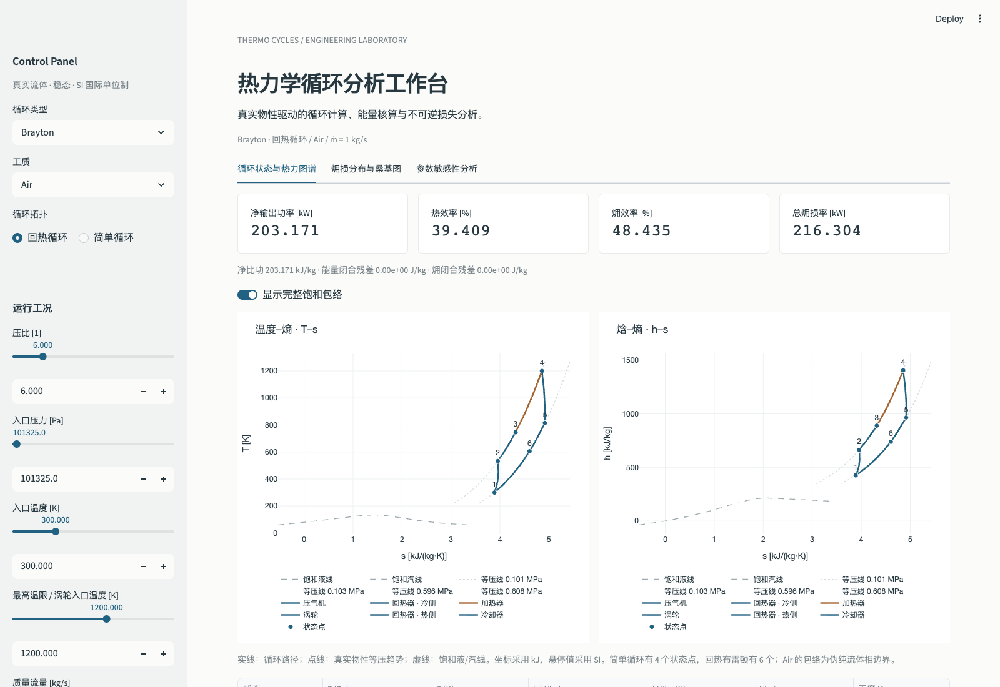

# Thermo Cycles

[中文](README.zh-CN.md) · [English](README.md) · [日本語](README.ja.md) · [Deutsch](README.de.md)

**Realfluid-Kreisprozesssimulation, Energiebilanzen und Exergieanalyse nach dem zweiten Hauptsatz für Forschung und Lehre.**

## Überblick und Funktionen

Das Projekt verbindet einen typisierten Python-Physikkern mit einem interaktiven Streamlit-/Plotly-Labor. Unterstützt werden einfache und rekuperierte geschlossene Brayton-Prozesse sowie einfache Rankine-Prozesse. CoolProp liefert reale Stoffeigenschaften statt konstanter idealer Wärmekapazitäten. Nachvollziehbare Annahmen, reproduzierbare Referenzen und die Trennung numerischer Verifikation von experimenteller Validierung stehen im Vordergrund.

Dieses Repository enthält ausschließlich stationäre thermodynamische Kreisprozesse. Motoren, Gegenkolben und Gaswechsel werden im eigenständigen [Modular 0D Framework](https://github.com/1844514356zjc-dev/modular-0d-framework) gepflegt.

- P–H-/P–S-Zustandsberechnungen für Air, CO2, R134a und Water innerhalb gültiger Stoff- und Phasenbereiche.
- Separate isentrope Wirkungsgrade von Verdichter, Pumpe und Turbine; Pumpenarbeit aus der realen Enthalpiedifferenz.
- Gegenstromrekuperator mit gleichen Massenströmen, Übertragungsgrad, unabhängigen Druckverlusten, variablen Stoffwerten und innerer Pinch-Prüfung.
- Spezifische Nettoarbeit, Wärmezufuhr/-abfuhr, thermischer Wirkungsgrad, physikalische Exergie, komponentenweise Exergiezerstörung und Bilanzresiduen.
- T–s-/h–s-Diagramme, Realfluid-Isobaren, Sättigungsgrenzen, Zustandsnummern, SI-Hoverwerte und Sankey-Diagramme für Energie und Exergie.
- Parameterscans mit Fehlermeldungen und bestem zulässigem Stichprobenpunkt für thermischen Wirkungsgrad oder spezifische Arbeit.
- Vollständige JSON-/CSV-Berichte mit Eingaben, Umweltzustand, Einheiten, Zuständen, dichten Pfaden, Softwareversionen und Warnungen.



## Schnellstart

Erforderlich sind Docker Engine / Desktop mit Compose oder Python 3.10+. Im Repository-Stammverzeichnis ausführen:

```bash
# Docker Compose
docker-compose up
# Docker Compose plugin
docker compose up --build
```

```bash
python -m venv .venv
source .venv/bin/activate
python -m pip install -c requirements/validation-constraints.txt -e '.[ui,dev,benchmark]'
python -m streamlit run src/ui/app.py
```


[http://localhost:8501](http://localhost:8501) öffnen. PowerShell-Aktivierung: `.venv\Scripts\Activate.ps1`. Der Container verwendet Python 3.10 slim, einen Benutzer ohne Root-Rechte, eine Zustandsprüfung und eine ausschließlich lokale Portbindung. Der erste Build benötigt Netzwerkzugriff; bei belegtem Port 8501 muss der bisherige Dienst gestoppt werden.

Die empfohlene lokale Installation begrenzt direkte Abhängigkeiten über `requirements/validation-constraints.txt`. Der Container bindet über `requirements.txt` eine vollständige Laufzeitsperrdatei mit SHA-256-Hashes ein. Wartungsupdates des Basisimages erlauben keine Aussage über byteidentische Gesamtimages.

## Architektur und Python-API

`src/core/cycle_solver.py` ist der UI-unabhängige SI-Physikkern, `src/ui/app.py` der Oberflächeneinstieg und `src/ui/dashboard.py` die Darstellungs-, Scan- und Berichtsschicht. Tests, unabhängige Vergleiche und Dokumentation liegen unter `tests/`, `benchmarks/` und `docs/`.

```python
from core.cycle_solver import (
    BraytonConfig,
    RankineConfig,
    solve_brayton,
    solve_rankine,
)

brayton = solve_brayton(BraytonConfig(), points=300)
rankine = solve_rankine(RankineConfig(), points=300)

print(brayton.thermal_efficiency)       # dimensionless
print(brayton.specific_work)            # J/kg
print(brayton.power)                    # W
print(brayton.exergy_destruction)       # J/kg, by component
print(brayton.destruction_rates)        # W, by component
print(rankine.states["4"].quality)      # wet-steam vapor mass fraction
```

## Mathematisches und physikalisches Modell

Die Rechnung ist stationär und vernachlässigt Änderungen kinetischer und potenzieller Energie. Maschinen sind adiabat. Externe Wärmequelle und Wärmesenke sind unendliche isotherme Reservoirs bei T_H und T_C; der Umgebungsreferenzzustand ist T0,p0. Einheiten sind K, Pa, J/kg, J/(kg·K), W und kg/s. Zugeführte Wärme, abgeführte Wärme und Nettoarbeitsabgabe werden jeweils positiv angegeben.

Die folgenden Gleichungen beschreiben nacheinander den isentropen Austritt, Verdichter-/Pumpenwirkungsgrad, Turbinenwirkungsgrad, Rekuperatorübertragungsgrad und Gegenstrom-Enthalpieverteilung, Druckverluste, ersten Hauptsatz, spezifische physikalische Exergie, Exergiezerstörung, Wärmeexergie und Exergiewirkungsgrad. Heizer- und Kühlerzerstörung enthalten den irreversiblen Wärmeaustausch mit den angegebenen Reservoirs. Der Rekuperator wird als gemeinsames Kontrollvolumen beider Ströme bilanziert.

$$
h_{b_s}=h(p_b,s_a).
$$

$$
\eta_c=\frac{h_{b_s}-h_a}{h_b-h_a},
\qquad
h_b=h_a+\frac{h_{b_s}-h_a}{\eta_c},
\qquad
w_c=h_b-h_a.
$$

$$
\eta_t=\frac{h_a-h_b}{h_a-h_{b_s}},
\qquad
h_b=h_a-\eta_t(h_a-h_{b_s}),
\qquad
w_t=h_a-h_b.
$$

$$
\varepsilon=\frac{q_{\mathrm{reg}}}{q_{\max}},
\qquad
h_{c,o}=h_{c,i}+q_{\mathrm{reg}},
\qquad
h_{h,o}=h_{h,i}-q_{\mathrm{reg}}.
$$

$$
h_c(x)=h_{c,i}+xq_{\mathrm{reg}},
\qquad
h_h(x)=h_{h,i}-(1-x)q_{\mathrm{reg}}.
$$

$$
p_o=(1-\delta)p_i,\qquad 0\leq\delta<1.
$$

$$
w_{\mathrm{net}}=w_t-w_{\mathrm{in}},
\qquad
\eta_{\mathrm{th}}=\frac{w_{\mathrm{net}}}{q_{\mathrm{in}}},
\qquad
\dot W_{\mathrm{net}}=\dot m\,w_{\mathrm{net}}.
$$

$$
r_E=q_{\mathrm{in}}-q_{\mathrm{out}}-w_{\mathrm{net}}.
$$

$$
e=(h-h_0)-T_0(s-s_0).
$$

$$
e_D=e_i-e_o+\sum_j\left(1-\frac{T_0}{T_j}\right)q_j-w,
\qquad
e_D=T_0s_{\mathrm{gen}}\geq0,
$$

$$
\begin{aligned}
e_{D,\mathrm{machine}} &= T_0(s_o-s_i),\\
e_{D,\mathrm{reg}} &= T_0\big[(s_{c,o}-s_{c,i})+(s_{h,o}-s_{h,i})\big],\\
e_{D,\mathrm{heater}} &= T_0\left[(s_o-s_i)-\frac{q_{\mathrm{in}}}{T_H}\right],\\
e_{D,\mathrm{cooler}} &= T_0\left[(s_o-s_i)+\frac{q_{\mathrm{out}}}{T_C}\right].
\end{aligned}
$$

$$
e_{Q,H}=\left(1-\frac{T_0}{T_H}\right)q_{\mathrm{in}},
\qquad
e_{Q,C}=\left(1-\frac{T_0}{T_C}\right)q_{\mathrm{out}}.
$$

$$
\eta_{\mathrm{II}}=\frac{w_{\mathrm{net}}}{e_{Q,H}},
\qquad
r_X=e_{Q,H}-e_{Q,C}-w_{\mathrm{net}}-\sum_k e_{D,k}.
$$

$$
\mathrm{Relative\ Error}\ [\%]
=100\frac{|y_{\mathrm{solver}}-y_{\mathrm{reference}}|}
{|y_{\mathrm{reference}}|}.
$$

Der Exergiewirkungsgrad verwendet die Exergie der Wärmezufuhr als Nenner. Bei T_C<T0 stellt auch die Wärmesenke Exergie bereit; der Wert ist dann kein auf sämtliche Ressourcen bezogener Gesamtwirkungsgrad. Das Sankey-Diagramm stellt negative Exergieabfuhr als umgekehrten Zufluss dar.

Der Rekuperator prüft 201 Stationen und bestimmt bei Bedarf die Grenzwärme mit dem Brent-Verfahren aus SciPy. Dies ist eine diskrete Pinch-Bedingung und kein Beweis für das gesamte kontinuierliche Gebiet. Auch dicht abgetastete Maschinenpfade beruhen weiterhin auf Interpolationsannahmen.

## Verifikation und Referenzvergleiche

Fall C ist ein idealer Rankine-Prozess mit Water: Kondensationsdruck 10 kPa, Kesselaustritt 8 MPa, Turbineneintritt 773,15 K, gesättigte Flüssigkeit am Pumpeneintritt, Maschinenwirkungsgrad1 und keine Druckverluste. Die unabhängige Python-Implementierung `iapws` von IAPWS-IF97 dient als Referenz; der Solver nutzt CoolProp HEOS. Aufgezeichnete Versionen: CoolProp 7.2.0 und iapws 1.5.5.

| Case | Metric | Unit | Reference | Solver | Relative error % | Limit % | Result |
|---|---|---|---:|---:|---:|---:|---|
| C: ideal Rankine | specific_work | J/kg | 1261148.31 | 1261205.12 | 0.00450501 | 0.15 | PASS |
| C: ideal Rankine | heat_input | J/kg | 3199501.94 | 3199627.31 | 0.00391823 | 0.15 | PASS |
| C: ideal Rankine | thermal_efficiency | 1 | 0.394170195 | 0.394172508 | 0.000586757 | 0.15 | PASS |
| C: ideal Rankine | x4 | 1 | 0.810323225 | 0.810359306 | 0.00445263 | 0.15 | PASS |
| C: ideal Rankine | h1 | J/kg | 191812.295 | 191805.945 | 0.00331086 | 0.15 | PASS |
| C: ideal Rankine | h2 | J/kg | 199870.651 | 199864.344 | 0.00315555 | 0.15 | PASS |
| C: ideal Rankine | h3 | J/kg | 3399372.59 | 3399491.65 | 0.00350232 | 0.15 | PASS |
| C: ideal Rankine | h4 | J/kg | 2130165.93 | 2130228.13 | 0.00291988 | 0.15 | PASS |

Alle acht Abweichungen dieses Falls liegen unter 0,1%, maximal bei etwa 0,00451%. Daraus folgt weder eine allgemeine Fehlergrenze für alle Fluide und Betriebszustände noch eine experimentelle Validierung. Der bestehende Skriptgrenzwert beträgt 0,15%. Der relative Fehler ist100×|Rechnung−Referenz|/|Referenz|; bei Referenzwert null sind absolute Fehler erforderlich.

A/B verwenden Air mit p1=100000 Pa, T1=300 K, Druckverhältnis4, T4=900 K, Maschinenwirkungsgrad1, Druckverlust0 und Übertragungsgrad0 bzw.0,75. Die analytische Referenz setzt cp=1004,5 J/(kg·K) und gamma=1,4 voraus, der Solver verwendet reale Stoffwerte:

| Case | Metric | Unit | Reference | Solver | Relative error % | Limit % | Result |
|---|---|---|---:|---:|---:|---:|---|
| A: simple Brayton | specific_work | J/kg | 149215.086 | 154249.456 | 3.3739 | 10 | PASS |
| A: simple Brayton | heat_input | J/kg | 456245.621 | 486798.623 | 6.69661 | 10 | PASS |
| A: simple Brayton | thermal_efficiency | 1 | 0.327049904 | 0.316865021 | 3.11417 | 10 | PASS |
| B: recuperated Brayton | specific_work | J/kg | 149215.086 | 154249.456 | 3.3739 | 10 | PASS |
| B: recuperated Brayton | heat_input | J/kg | 335813.504 | 347401.311 | 3.45067 | 10 | PASS |
| B: recuperated Brayton | thermal_efficiency | 1 | 0.444339148 | 0.444009423 | 0.0742057 | 10 | PASS |

Dies sind Stoffmodellunterschiede, keine Diskretisierungsfehler; 10% ist nur eine beispielhafte Modellkonsistenzgrenze. Die drei Fälle wurden aus klassischen Modellen konstruiert. Sie sind weder Abschriften nummerierter Lehrbuchaufgaben noch offizielle NIST-Zertifizierungsdaten.

```bash
python -m flake8 src tests benchmarks examples
python -m pytest -q
python benchmarks/validate_literature.py
```


Die Tests decken Energie-/Exergieschluss unter1e-6 J/kg für die angegebenen Grenzfälle, ideale Grenzmodelle, ungültige Eingaben, Nassdampf, Massenstromskalierung, Sankey-Bilanzen, Exporte und UI-Verhalten ab. GitHub Actions ist für Python 3.10/3.12/3.14 sowie Container-Build, Zustandsprüfung und Berechnungs-Smoke-Tests konfiguriert. Den tatsächlichen Ausführungsstatus zeigt Actions.

## Grenzen und geplante Arbeiten

- Brayton ist ein geschlossener extern beheizter Prozess ohne Verbrennung, chemische Exergie oder offenes Gasturbinenabgasmodell.
- Rankine ist ein einfacher Prozess ohne Anzapfvorwärmung oder Zwischenüberhitzung. Nassdampfexpansion enthält weder Tropfenerosion noch Nichtgleichgewichtskondensation.
- Unterstützt werden reine und passende pseudoreine Fluide im Gültigkeitsbereich; beliebige Gemisch-Phasengrenzen und Festkörper sind nicht enthalten.
- Die pseudoreinen Air-Phasengrenzen sind keine exakte Reinstoff-Sättigungsglocke. Endpunktwirkungsgrade legen interne Maschinenpfade nicht eindeutig fest.
- Geplant sind beschränkte und mehrzielige Pareto-Optimierung mit SciPy, Rekompressions-/Teilstromprozesse mit überkritischem CO2, endliche UA-Modelle und adaptive Pinch-Suche, Rankine mit Zwischenüberhitzung, unabhängige experimentelle Vergleiche und Unsicherheitsfortpflanzung.

Weitere Angaben stehen in [Physik](docs/physics.md), [Dashboard](docs/dashboard.md), [Benchmark-Methodik](benchmarks/README.md) und im ausführlichen englischen README.

## Beiträge und Lizenz

Siehe [CONTRIBUTING.md](CONTRIBUTING.md) und [MIT-Lizenz](LICENSE). Abhängigkeiten behalten ihre eigenen Lizenzen. Technische Quellen: [CoolProp-API](https://coolprop.org/coolprop/HighLevelAPI.html), [IAPWS-IF97](https://iapws.org/technical-guidance/release/IF97-Rev), [iapws-Implementierung](https://iapws.readthedocs.io/en/latest/iapws.iapws97.html).
