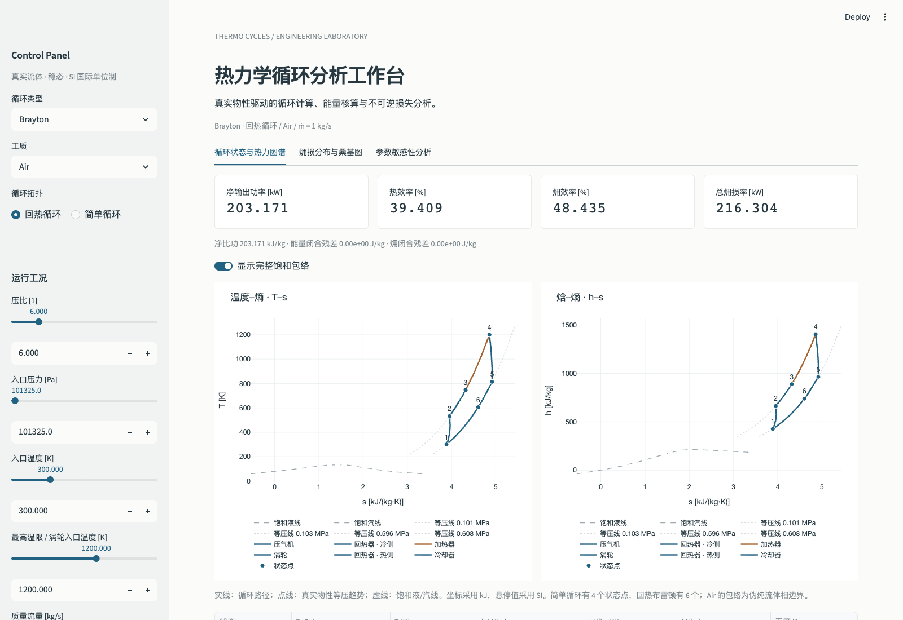

# Thermo Cycles

[中文](README.zh-CN.md) · [English](README.md) · [日本語](README.ja.md) · [Deutsch](README.de.md)

**工学研究・教育のための実在流体サイクル計算、エネルギー収支および第二法則に基づくエクセルギー解析。**

## 概要と機能

型注釈付き Python コアと Streamlit / Plotly の対話環境を組み合わせ、単純・再生式の閉じたブレイトンサイクルと単純ランキンサイクルを計算します。一定比熱を仮定せず、CoolProp の実在流体物性を使います。仮定の追跡可能性、参照計算の再現性、数値的検証と実験検証の区別を重視します。

このリポジトリは定常サイクル専用です。エンジン、対向ピストン、ガス交換モデルは独立した [Modular 0D Framework](https://github.com/1844514356zjc-dev/modular-0d-framework) にあります。

- Air、CO2、R134a、Water を対象に P–H / P–S フラッシュを実行します。有効物性範囲と相条件を満たす必要があります。
- 圧縮機・ポンプ・タービンそれぞれの等エントロピー効率を設定します。ポンプ仕事も実在流体のエンタルピー差から求めます。
- 等質量流量の向流再生器に有効度、両側の圧力損失、変化する物性、内部ピンチ制約を組み込みます。
- 正味比仕事、受熱・放熱、熱効率、物理エクセルギー、機器別エクセルギー破壊、収支残差を出力します。
- T–s / h–s 図、等圧線、飽和包絡線、状態番号、SI ホバー値、エネルギー・エクセルギーのサンキー図を表示します。
- パラメータ走査では失敗点と診断を保持し、指定目的に対する最良の実行可能サンプルを示します。
- JSON / CSV は入力、環境、単位、状態、密な経路、依存バージョン、警告を含む完全な報告です。



## クイックスタート

Docker Engine / Desktop と Compose、または Python 3.10+ が必要です。リポジトリのルートで実行します。

```bash
# Docker Compose
docker-compose up
# Docker Compose plugin
docker compose up --build
```

```bash
python -m venv .venv
source .venv/bin/activate
python -m pip install -c requirements/validation-constraints.txt -e '.[ui,dev,benchmark]'
python -m streamlit run src/ui/app.py
```


[http://localhost:8501](http://localhost:8501) を開きます。PowerShell の有効化は `.venv\Scripts\Activate.ps1` です。コンテナは Python 3.10 slim、非 root ユーザ、ヘルスチェック、ループバック限定のポート公開を使います。初回ビルドにはネットワークが必要です。8501 が使用中なら既存サービスを停止してください。

推奨のローカル導入は `requirements/validation-constraints.txt` で直接依存を制約します。コンテナは `requirements.txt` 経由で SHA-256 ハッシュ付きの完全な実行時ロックを使用します。ベースイメージの保守更新があるため、イメージ全体のバイト単位の再現性は保証しません。

## 構成と Python API

`src/core/cycle_solver.py` は UI 非依存の SI 物理コア、`src/ui/app.py` は UI 入口、`src/ui/dashboard.py` は可視化・走査・出力層です。テスト、参照比較、文書は `tests/`、`benchmarks/`、`docs/` にあります。

```python
from core.cycle_solver import (
    BraytonConfig,
    RankineConfig,
    solve_brayton,
    solve_rankine,
)

brayton = solve_brayton(BraytonConfig(), points=300)
rankine = solve_rankine(RankineConfig(), points=300)

print(brayton.thermal_efficiency)       # dimensionless
print(brayton.specific_work)            # J/kg
print(brayton.power)                    # W
print(brayton.exergy_destruction)       # J/kg, by component
print(brayton.destruction_rates)        # W, by component
print(rankine.states["4"].quality)      # wet-steam vapor mass fraction
```

## 数学・物理モデル

定常状態で運動・位置エネルギー変化を無視し、機械を断熱とします。外部熱源 T_H と冷却源 T_C は無限の等温熱源、環境基準状態は T0、p0 です。単位は K、Pa、J/kg、J/(kg·K)、W、kg/s を用います。受熱、放熱、正味出力仕事をそれぞれ正とします。

以下は等エントロピー出口、圧縮機・ポンプ効率、タービン効率、再生器有効度と向流エンタルピー分布、圧力損失、第一法則、物理エクセルギー、機器別破壊量、熱のエクセルギー、第二法則効率の順です。加熱器・冷却器の破壊量は指定熱源との不可逆伝熱を含み、再生器は二流体を合わせた検査体積で評価します。

$$
h_{b_s}=h(p_b,s_a).
$$

$$
\eta_c=\frac{h_{b_s}-h_a}{h_b-h_a},
\qquad
h_b=h_a+\frac{h_{b_s}-h_a}{\eta_c},
\qquad
w_c=h_b-h_a.
$$

$$
\eta_t=\frac{h_a-h_b}{h_a-h_{b_s}},
\qquad
h_b=h_a-\eta_t(h_a-h_{b_s}),
\qquad
w_t=h_a-h_b.
$$

$$
\varepsilon=\frac{q_{\mathrm{reg}}}{q_{\max}},
\qquad
h_{c,o}=h_{c,i}+q_{\mathrm{reg}},
\qquad
h_{h,o}=h_{h,i}-q_{\mathrm{reg}}.
$$

$$
h_c(x)=h_{c,i}+xq_{\mathrm{reg}},
\qquad
h_h(x)=h_{h,i}-(1-x)q_{\mathrm{reg}}.
$$

$$
p_o=(1-\delta)p_i,\qquad 0\leq\delta<1.
$$

$$
w_{\mathrm{net}}=w_t-w_{\mathrm{in}},
\qquad
\eta_{\mathrm{th}}=\frac{w_{\mathrm{net}}}{q_{\mathrm{in}}},
\qquad
\dot W_{\mathrm{net}}=\dot m\,w_{\mathrm{net}}.
$$

$$
r_E=q_{\mathrm{in}}-q_{\mathrm{out}}-w_{\mathrm{net}}.
$$

$$
e=(h-h_0)-T_0(s-s_0).
$$

$$
e_D=e_i-e_o+\sum_j\left(1-\frac{T_0}{T_j}\right)q_j-w,
\qquad
e_D=T_0s_{\mathrm{gen}}\geq0,
$$

$$
\begin{aligned}
e_{D,\mathrm{machine}} &= T_0(s_o-s_i),\\
e_{D,\mathrm{reg}} &= T_0\big[(s_{c,o}-s_{c,i})+(s_{h,o}-s_{h,i})\big],\\
e_{D,\mathrm{heater}} &= T_0\left[(s_o-s_i)-\frac{q_{\mathrm{in}}}{T_H}\right],\\
e_{D,\mathrm{cooler}} &= T_0\left[(s_o-s_i)+\frac{q_{\mathrm{out}}}{T_C}\right].
\end{aligned}
$$

$$
e_{Q,H}=\left(1-\frac{T_0}{T_H}\right)q_{\mathrm{in}},
\qquad
e_{Q,C}=\left(1-\frac{T_0}{T_C}\right)q_{\mathrm{out}}.
$$

$$
\eta_{\mathrm{II}}=\frac{w_{\mathrm{net}}}{e_{Q,H}},
\qquad
r_X=e_{Q,H}-e_{Q,C}-w_{\mathrm{net}}-\sum_k e_{D,k}.
$$

$$
\mathrm{Relative\ Error}\ [\%]
=100\frac{|y_{\mathrm{solver}}-y_{\mathrm{reference}}|}
{|y_{\mathrm{reference}}|}.
$$

第二法則効率の分母は受熱エクセルギーです。T_C<T0 では冷却源もエクセルギーを供給するため、全資源投入に対する総合効率ではありません。サンキー図は負の放熱エクセルギーを逆向きの流入として示します。

再生器は201点で温度差を確認し、必要に応じて SciPy の Brent 法で限界熱量を求めます。これは離散的な制約であり、連続領域での非交差の証明ではありません。密な機械経路も補間仮定に依存します。

## 参照計算による検証

C は Water の理想ランキン：凝縮圧力 10 kPa、ボイラ出口 8 MPa、タービン入口 773.15 K、ポンプ入口は飽和液、機械効率1、圧力損失0です。独立した Python `iapws` の IAPWS-IF97 を参照し、本ソルバは CoolProp HEOS を使います。記録バージョンは CoolProp 7.2.0、iapws 1.5.5 です。

| Case | Metric | Unit | Reference | Solver | Relative error % | Limit % | Result |
|---|---|---|---:|---:|---:|---:|---|
| C: ideal Rankine | specific_work | J/kg | 1261148.31 | 1261205.12 | 0.00450501 | 0.15 | PASS |
| C: ideal Rankine | heat_input | J/kg | 3199501.94 | 3199627.31 | 0.00391823 | 0.15 | PASS |
| C: ideal Rankine | thermal_efficiency | 1 | 0.394170195 | 0.394172508 | 0.000586757 | 0.15 | PASS |
| C: ideal Rankine | x4 | 1 | 0.810323225 | 0.810359306 | 0.00445263 | 0.15 | PASS |
| C: ideal Rankine | h1 | J/kg | 191812.295 | 191805.945 | 0.00331086 | 0.15 | PASS |
| C: ideal Rankine | h2 | J/kg | 199870.651 | 199864.344 | 0.00315555 | 0.15 | PASS |
| C: ideal Rankine | h3 | J/kg | 3399372.59 | 3399491.65 | 0.00350232 | 0.15 | PASS |
| C: ideal Rankine | h4 | J/kg | 2130165.93 | 2130228.13 | 0.00291988 | 0.15 | PASS |

C の8項目はすべて0.1%未満で、最大は約0.00451%です。全流体・全運転条件に通用する誤差上限でも実験検証でもありません。スクリプトの既定閾値は0.15%です。相対誤差は100×|計算−参照|/|参照|、参照がゼロなら絶対誤差を使います。

A/B は Air、p1=100000 Pa、T1=300 K、圧力比4、T4=900 K、機械効率1、圧力損失0、有効度0 / 0.75です。解析参照の cp=1004.5 J/(kg·K)、gamma=1.4 に対し、本計算は実在物性です。

| Case | Metric | Unit | Reference | Solver | Relative error % | Limit % | Result |
|---|---|---|---:|---:|---:|---:|---|
| A: simple Brayton | specific_work | J/kg | 149215.086 | 154249.456 | 3.3739 | 10 | PASS |
| A: simple Brayton | heat_input | J/kg | 456245.621 | 486798.623 | 6.69661 | 10 | PASS |
| A: simple Brayton | thermal_efficiency | 1 | 0.327049904 | 0.316865021 | 3.11417 | 10 | PASS |
| B: recuperated Brayton | specific_work | J/kg | 149215.086 | 154249.456 | 3.3739 | 10 | PASS |
| B: recuperated Brayton | heat_input | J/kg | 335813.504 | 347401.311 | 3.45067 | 10 | PASS |
| B: recuperated Brayton | thermal_efficiency | 1 | 0.444339148 | 0.444009423 | 0.0742057 | 10 | PASS |

この差は物性モデル差であり、離散化誤差ではありません。10%は例示的なモデル整合性のスクリーニング値です。3例は古典モデルから構成した参照研究であり、教科書の番号付き例題の転記や NIST の公式認証データではありません。

```bash
python -m flake8 src tests benchmarks examples
python -m pytest -q
python benchmarks/validate_literature.py
```


サイクルのテストは指定境界で1e-6 J/kg未満のエネルギー・エクセルギー収支、理想極限、不正入力、湿り蒸気、流量スケーリング、サンキー収支、出力、UI 動作を扱います。GitHub Actions は Python 3.10/3.12/3.14、コンテナのビルド・ヘルス・計算を検査する設定です。実際の実行結果は Actions を参照してください。

## 制限と今後の課題

- ブレイトンは外部加熱の閉サイクルで、燃焼、化学エクセルギー、開放型ガスタービン排気を含みません。
- ランキンは抽気給水加熱・再熱なしの単純サイクルです。湿り膨張に液滴侵食や非平衡凝縮は含みません。
- 有効域内の純流体と対応する擬似純流体が対象で、任意混合物の相包絡線や固体は扱いません。
- Air の擬似純流体包絡線は厳密な純物質の飽和ドームではありません。端点効率だけでは内部機械経路は一意に決まりません。
- SciPy による制約・多目的 Pareto 最適化、超臨界 CO2 の再圧縮・分流サイクル、有限 UA と適応ピンチ探索、再熱ランキン、独立実験データと不確かさ伝播を今後拡張します。

詳細は[物理モデル](docs/physics.md)、[ダッシュボード](docs/dashboard.md)、[検証方法](benchmarks/README.md)と英語 README にあります。

## 貢献とライセンス

[CONTRIBUTING.md](CONTRIBUTING.md)、[MIT License](LICENSE) を参照してください。依存ライブラリは各自のライセンスに従います。技術資料：[CoolProp API](https://coolprop.org/coolprop/HighLevelAPI.html)、[IAPWS-IF97](https://iapws.org/technical-guidance/release/IF97-Rev)、[iapws 実装](https://iapws.readthedocs.io/en/latest/iapws.iapws97.html)。
