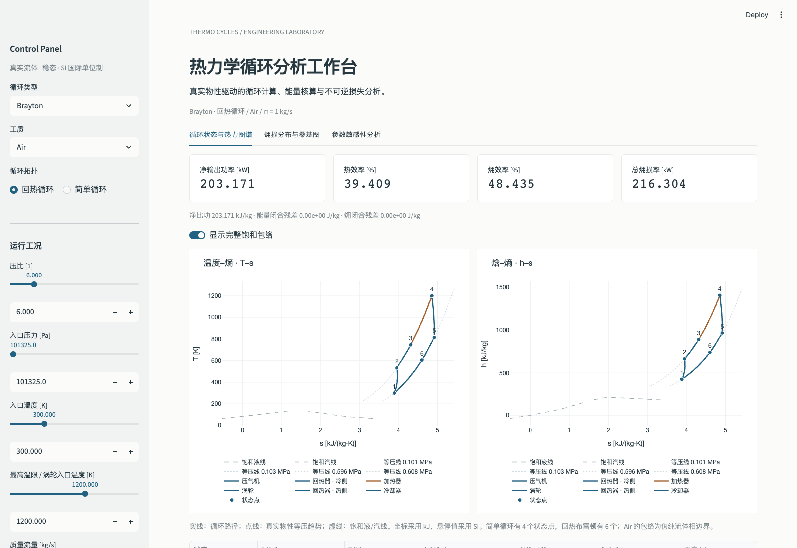

# Thermo Cycles

[中文](README.zh-CN.md) · [English](README.md) · [日本語](README.ja.md) · [Deutsch](README.de.md)

**Real-fluid thermodynamic cycle simulation, first-law accounting, and
second-law exergy analysis for engineering research and teaching.**

Thermo Cycles connects a typed Python physics kernel to an interactive
Streamlit and Plotly laboratory. It supports simple and recuperated closed
Brayton cycles and simple Rankine cycles, with thermophysical properties
provided by CoolProp rather than fixed ideal-gas heat capacities.

The project emphasizes inspectable assumptions, reproducible reference cases,
and a clear distinction between numerical verification and physical validation.
It is intended for cycle studies, classroom demonstrations, and research
prototyping. Experimental validation remains future work.



## Core capabilities

- **Real-fluid properties:** CoolProp mass-specific pressure–enthalpy and
  pressure–entropy flashes for Air, CO2, R134a, and Water, where operating
  conditions and phase support permit.
- **Irreversible machinery:** separate isentropic efficiencies for compressors,
  pumps, and turbines; exact real-fluid pump enthalpy changes instead of a
  constant-specific-volume approximation.
- **Recuperation with losses:** equal-flow counterflow recuperator effectiveness,
  independent hot/cold pressure losses, variable fluid properties, and a
  numerical internal-pinch check.
- **First and second laws:** net specific work, heat input/rejection, thermal
  efficiency, physical exergy, component exergy destruction, and explicit
  conservation residuals.
- **Engineering visualization:** interactive T–s and h–s diagrams, numbered
  states, real-fluid isobars, saturation boundaries, energy/exergy Sankey
  diagrams, and component destruction shares.
- **Design exploration:** one-variable parameter sweeps, failed-point
  diagnostics, dual-axis performance plots, and the best feasible sampled
  design for a selected objective.
- **Traceable exports:** complete SI reports in JSON or long-format CSV,
  including inputs, environmental assumptions, states, dense paths, software
  versions, and warnings.
- **Quality checks:** Flake8, pytest, independent reference comparisons, and a
  GitHub Actions container-build/health/calculation smoke-test job.

## Quick start

Use this directory, containing `pyproject.toml` and `.github/`, as the repository
root. Both installation methods expose the dashboard at
[http://localhost:8501](http://localhost:8501).

### Option A — Docker: one command

**Prerequisite:** a running Docker Engine with Docker Compose, or Docker Desktop.
No host Python installation is required. The first build needs network access
to obtain the base image and Python packages.

```bash
docker-compose up
```

With the current Compose plugin, the equivalent command is:

```bash
docker compose up
```

Compose automatically builds the application image when it is absent. To
rebuild after source or dependency changes, run:

```bash
docker compose up --build
```

For detached operation and shutdown:

```bash
docker compose up -d
docker compose ps
docker compose logs -f
docker compose down
```

The container uses Python 3.10 on Debian Bookworm, a non-root runtime user,
prebuilt numerical-library wheels, and a fully pinned transitive runtime lock
with SHA-256 package hashes. Its health check queries
`/_stcore/health`. The service is bound to the local loopback interface on port
8501; no database, credentials, bind-mounted source tree, or external API is
needed. Downloads are generated in the browser session; there is no persistent
server-side report database.

If port 8501 is already occupied, stop the earlier local Streamlit process or
container before starting Compose. The `python:3.10-slim-bookworm` base tag
receives maintenance updates; package locking does not imply bit-for-bit
reproducibility of the entire operating-system image.

### Option B — local Python

Python **3.10 or newer** is required. Python 3.10 is the container reference
version. Create a dedicated environment to avoid mixing numerical-library
versions with unrelated projects:

```bash
python -m venv .venv
source .venv/bin/activate
python -m pip install --upgrade pip
python -m pip install -c requirements/validation-constraints.txt -e '.[ui,dev,benchmark]'
python -m streamlit run src/ui/app.py
```

On Windows PowerShell, replace the activation command with:

```powershell
.venv\Scripts\Activate.ps1
```

Start Streamlit from the repository root to load the supplied
`.streamlit/config.toml` theme. The recommended local command constrains direct dependencies with
`requirements/validation-constraints.txt`, including a compatible NumPy/SciPy
pair for Python 3.10. The package metadata retains supported ranges for library
consumers; Docker additionally locks all transitive runtime dependencies in
`requirements/docker.txt`. The optional `plot` extra installs
Matplotlib for standalone plotting workflows; the dashboard uses Plotly.

## Architecture and programmatic use

```text
thermo-cycles/
├── src/
│   ├── core/cycle_solver.py        # SI state, component and cycle calculations
│   └── ui/
│       ├── app.py                 # Streamlit controls and three-tab dashboard
│       └── dashboard.py           # Plotly, studies and report serialization
├── tests/
│   ├── test_cycle_solver.py
│   ├── test_thermodynamics.py
│   └── test_dashboard.py
├── benchmarks/
│   ├── validate_literature.py      # Independent formulas / IF97 comparison
│   └── validation_report.md
├── docs/                          # Model details and dashboard screenshots
├── examples/solve_cycles.py
├── requirements/
│   ├── docker.in                  # Reviewed direct runtime pins
│   ├── docker.txt                 # Full transitive lock with artifact hashes
│   └── validation-constraints.txt # Reviewed direct pins for local use / CI
├── .github/workflows/ci.yml
├── .streamlit/config.toml
├── .flake8
├── .dockerignore
├── Dockerfile
├── docker-compose.yml
├── pyproject.toml
├── CONTRIBUTING.md
└── LICENSE
```

The core has no UI dependency. The UI adapts complete solver outputs and does
not redefine the thermodynamic equations.

```python
from core.cycle_solver import (
    BraytonConfig,
    RankineConfig,
    solve_brayton,
    solve_rankine,
)

brayton = solve_brayton(BraytonConfig(), points=300)
rankine = solve_rankine(RankineConfig(), points=300)

print(brayton.thermal_efficiency)       # dimensionless
print(brayton.specific_work)            # J/kg
print(brayton.power)                    # W
print(brayton.exergy_destruction)       # J/kg, by component
print(brayton.destruction_rates)        # W, by component
print(rankine.states["4"].quality)      # wet-steam vapor mass fraction
```

## Mathematical and physical model

### Assumptions, notation, and units

The model is steady state, with negligible kinetic and potential energy changes.
Turbomachinery is adiabatic. The recuperator has equal mass flow on both sides
and no heat exchange with its surroundings. External heating and cooling are
represented by infinite isothermal reservoirs at $T_H$ and $T_C$.

All solver inputs and outputs use SI:

| Quantity | Symbol | Unit |
|---|---|---|
| Pressure | $p$ | Pa |
| Temperature | $T$ | K |
| Specific enthalpy | $h$ | J/kg |
| Specific entropy | $s$ | J/(kg·K) |
| Specific work, heat and physical exergy | $w,q,e$ | J/kg |
| Mass flow | $\dot m$ | kg/s |
| Power and exergy destruction rate | $\dot W,\dot E_D$ | W |
| Efficiencies, effectiveness, pressure-loss fraction | $\eta,\varepsilon,\delta$ | 1 |

Plot axes and KPI cards may display explicitly labelled kJ or kW values;
report exports remain in SI. Positive $q_{\mathrm{in}}$, $q_{\mathrm{out}}$,
and $w_{\mathrm{net}}$ denote heat absorbed, heat rejected, and net shaft work
produced, respectively.

### Compressor and pump

For inlet state $a$, outlet pressure $p_b$, and the corresponding isentropic
outlet $b_s$, CoolProp supplies

$$
h_{b_s}=h(p_b,s_a).
$$

The compressor or pump efficiency and actual outlet enthalpy are

$$
\eta_c=\frac{h_{b_s}-h_a}{h_b-h_a},
\qquad
h_b=h_a+\frac{h_{b_s}-h_a}{\eta_c},
\qquad
w_c=h_b-h_a.
$$

The same relation applies to the pump with efficiency $\eta_p$. Pump work is
obtained from the real-fluid equation of state, rather than assuming
$w_p=v\Delta p$.

### Turbine or expander

$$
\eta_t=\frac{h_a-h_b}{h_a-h_{b_s}},
\qquad
h_b=h_a-\eta_t(h_a-h_{b_s}),
\qquad
w_t=h_a-h_b.
$$

Wet equilibrium expansion is permitted when supported by the property backend;
outlet quality is reported. No droplet-erosion or nonequilibrium-condensation
model is included.

### Recuperator effectiveness, pinch, and pressure losses

For equal mass flows, recovered heat per unit working-fluid mass is

$$
\varepsilon=\frac{q_{\mathrm{reg}}}{q_{\max}},
\qquad
h_{c,o}=h_{c,i}+q_{\mathrm{reg}},
\qquad
h_{h,o}=h_{h,i}-q_{\mathrm{reg}}.
$$

Here $q_{\max}$ is constrained by endpoint enthalpy limits and the internal
counterflow temperature approach, accounting for variable real-fluid
properties. With $x$ increasing along the cold stream,

$$
h_c(x)=h_{c,i}+xq_{\mathrm{reg}},
\qquad
h_h(x)=h_{h,i}-(1-x)q_{\mathrm{reg}}.
$$

The implementation checks $T_h(x)-T_c(x)\geq0$ at 201 stations and uses SciPy's
Brent root solver when the limiting heat transfer requires a root. This is a
sampled pinch constraint, not a continuous-domain proof. Pressure varies
linearly along each heat-exchanger stream, with fractional loss

$$
p_o=(1-\delta)p_i,\qquad 0\leq\delta<1.
$$

The pressure loop includes both recuperator sides and the external heat
exchangers when determining the turbine back pressure. With no thermal driving
force, heat recovery is bypassed while specified pressure losses remain.

### First-law accounting

$$
w_{\mathrm{net}}=w_t-w_{\mathrm{in}},
\qquad
\eta_{\mathrm{th}}=\frac{w_{\mathrm{net}}}{q_{\mathrm{in}}},
\qquad
\dot W_{\mathrm{net}}=\dot m\,w_{\mathrm{net}}.
$$

Here $w_{\mathrm{in}}$ is compressor work for Brayton or pump work for Rankine.
The reported energy residual is

$$
r_E=q_{\mathrm{in}}-q_{\mathrm{out}}-w_{\mathrm{net}}.
$$

### Physical exergy and exergy destruction

For environmental dead state $(T_0,p_0)$, evaluated using the same fluid backend,

$$
e=(h-h_0)-T_0(s-s_0).
$$

Chemical, kinetic, and potential exergy are excluded. A one-inlet/one-outlet
component obeys the specific exergy balance

$$
e_D=e_i-e_o+\sum_j\left(1-\frac{T_0}{T_j}\right)q_j-w,
\qquad
e_D=T_0s_{\mathrm{gen}}\geq0,
$$

where $q_j$ is positive into the component and $w$ is positive out. The
component-specific expressions used by the solver are

$$
\begin{aligned}
e_{D,\mathrm{machine}} &= T_0(s_o-s_i),\\
e_{D,\mathrm{reg}} &= T_0\big[(s_{c,o}-s_{c,i})+(s_{h,o}-s_{h,i})\big],\\
e_{D,\mathrm{heater}} &= T_0\left[(s_o-s_i)-\frac{q_{\mathrm{in}}}{T_H}\right],\\
e_{D,\mathrm{cooler}} &= T_0\left[(s_o-s_i)+\frac{q_{\mathrm{out}}}{T_C}\right].
\end{aligned}
$$

Heater and cooler destruction include the irreversibility of transfer to/from
the specified reservoirs. The recuperator is accounted for as a combined
two-stream control volume. Destruction rates are
$\dot E_{D,k}=\dot m\,e_{D,k}$.

The heat-input and rejected-heat exergies are

$$
e_{Q,H}=\left(1-\frac{T_0}{T_H}\right)q_{\mathrm{in}},
\qquad
e_{Q,C}=\left(1-\frac{T_0}{T_C}\right)q_{\mathrm{out}}.
$$

The reported exergy efficiency and closure residual are

$$
\eta_{\mathrm{II}}=\frac{w_{\mathrm{net}}}{e_{Q,H}},
\qquad
r_X=e_{Q,H}-e_{Q,C}-w_{\mathrm{net}}-\sum_k e_{D,k}.
$$

This definition uses heat-input exergy as its denominator. If $T_C<T_0$, the cold
reservoir also supplies exergy; the Sankey diagram reverses that branch, and
$\eta_{\mathrm{II}}$ should not be interpreted as an efficiency based on *all*
resource inputs. Reservoir temperatures are checked against the direction of
heat transfer.

## Verification and reference comparisons

### Test coverage

The current suite contains **44 passing tests** in the recorded development
environment. It covers:

- absolute first-law and exergy closure residuals below $10^{-6}$ J/kg for
  the specified boundary cases;
- isentropic machines, zero recuperation, pressure ratio one and nearby values;
- the exact constant-$c_p$ ideal-gas algebraic limit using a scoped test adapter;
- invalid temperatures, fluid names, efficiencies and pressure losses;
- wet-steam expansion, saturation-boundary samples, and rate scaling;
- Sankey balance, including a cold reservoir below $T_0$;
- report completeness, UI state numbering, linked controls, failed scans, and
  invalidation of stale results.

A unit pressure ratio is accepted only if the pressure loop is feasible and
external heat input remains positive. The resulting zero-work cycle has zero
reported efficiencies. A zero-heat-input cycle is rejected because its
thermal-efficiency denominator vanishes. Unit machine efficiency removes
machine irreversibility; it does not make finite-temperature-difference heat
transfer reversible.

### Independent water/steam reference: observed errors below 0.1%

Case C is a constructed classical ideal Rankine cycle: Water, condenser
pressure **10 kPa**, boiler outlet pressure **8 MPa**, turbine inlet temperature
**773.15 K**, saturated-liquid pump inlet, unit machine efficiencies, and zero
pressure losses.

The reference is generated independently using the Python `iapws` implementation
of [IAPWS-IF97](https://iapws.org/technical-guidance/release/IF97-Rev). It does
not reuse the solver's state functions or CoolProp flashes. The solver uses
CoolProp's HEOS water model. Differences therefore include equation-of-state
and backward-equation differences, in addition to numerical effects.

Recorded versions: **CoolProp 7.2.0; iapws 1.5.5**. The table below is reproduced
from the [benchmark report](benchmarks/validation_report.md).

| Case | Metric | Unit | Reference | Solver | Relative error % | Limit % | Result |
|---|---|---|---:|---:|---:|---:|---|
| C: ideal Rankine | specific_work | J/kg | 1261148.31 | 1261205.12 | 0.00450501 | 0.15 | PASS |
| C: ideal Rankine | heat_input | J/kg | 3199501.94 | 3199627.31 | 0.00391823 | 0.15 | PASS |
| C: ideal Rankine | thermal_efficiency | 1 | 0.394170195 | 0.394172508 | 0.000586757 | 0.15 | PASS |
| C: ideal Rankine | x4 | 1 | 0.810323225 | 0.810359306 | 0.00445263 | 0.15 | PASS |
| C: ideal Rankine | h1 | J/kg | 191812.295 | 191805.945 | 0.00331086 | 0.15 | PASS |
| C: ideal Rankine | h2 | J/kg | 199870.651 | 199864.344 | 0.00315555 | 0.15 | PASS |
| C: ideal Rankine | h3 | J/kg | 3399372.59 | 3399491.65 | 0.00350232 | 0.15 | PASS |
| C: ideal Rankine | h4 | J/kg | 2130165.93 | 2130228.13 | 0.00291988 | 0.15 | PASS |

All eight reported Case C discrepancies are **below 0.1%**; the largest is
approximately **0.00451%**. The existing screening limit is **0.15%**, as declared
by the benchmark script. The observed results do not imply a universal 0.1%
error bound over all fluids and operating conditions, nor experimental
validation. Relative error is defined as

$$
\mathrm{Relative\ Error}\ [\%]
=100\frac{|y_{\mathrm{solver}}-y_{\mathrm{reference}}|}
{|y_{\mathrm{reference}}|}.
$$

Zero references require absolute-error checks instead.

### Air-standard comparisons: model differences retained explicitly

Cases A and B use Air at $p_1=100000$ Pa, $T_1=300$ K, pressure ratio 4,
$T_4=900$ K, unit machine efficiencies, and zero pressure losses, with
recuperator effectiveness 0 and 0.75, respectively. The independent analytic
reference assumes $c_p=1004.5$ J/(kg·K) and $\gamma=1.4$; the production solver
uses real Air properties.

| Case | Metric | Unit | Reference | Solver | Relative error % | Limit % | Result |
|---|---|---|---:|---:|---:|---:|---|
| A: simple Brayton | specific_work | J/kg | 149215.086 | 154249.456 | 3.3739 | 10 | PASS |
| A: simple Brayton | heat_input | J/kg | 456245.621 | 486798.623 | 6.69661 | 10 | PASS |
| A: simple Brayton | thermal_efficiency | 1 | 0.327049904 | 0.316865021 | 3.11417 | 10 | PASS |
| B: recuperated Brayton | specific_work | J/kg | 149215.086 | 154249.456 | 3.3739 | 10 | PASS |
| B: recuperated Brayton | heat_input | J/kg | 335813.504 | 347401.311 | 3.45067 | 10 | PASS |
| B: recuperated Brayton | thermal_efficiency | 1 | 0.444339148 | 0.444009423 | 0.0742057 | 10 | PASS |

The 10% limits above are broad **model-consistency screening limits**, not
numerical-accuracy targets. These discrepancies must not be described as
solver discretization errors or hidden when reporting the water/steam
comparison. The exact ideal-gas-limit unit test separately isolates algebraic
correctness from real-fluid property differences. The cycle framework follows
[Northwestern University's air-standard cycle teaching material](https://qrg.northwestern.edu/thermo/design-library/airstd/brayton.html).

These three cases are explicitly constructed reference studies, not claimed
transcriptions of numbered Moran–Shapiro or Çengel examples, and not official
NIST cycle-certification data.

### Reproduce the checks

```bash
python -m flake8 src tests benchmarks examples --count --show-source --statistics
python -m pytest -q
python benchmarks/validate_literature.py
```

The benchmark prints a Markdown table and returns a nonzero exit status when
a comparison exceeds its declared limit. Missing reference dependencies and
invalid states fail visibly. See [benchmark methodology](benchmarks/README.md)
for the reference construction and interpretation.

## Interactive dashboard

1. Select the fluid, cycle family, and supported topology in the control panel.
2. Set SI operating conditions, isentropic efficiencies, pressure losses, and
   the environmental and reservoir reference temperatures.
3. Inspect the four KPIs, T–s/h–s paths, numbered state table, and SI hover data.
4. Review separate energy/exergy Sankey diagrams and component losses.
5. Run a parameter sweep and select maximum thermal efficiency or maximum
   specific work as the objective.
6. Download the complete current-condition report as JSON or CSV; sweep samples
   and failure diagnostics can also be exported as JSON.

Simple Brayton displays four state labels mapped to the core's states
1, 2, 4, 5; recuperated Brayton retains all six states. Rankine uses four states.
Exports preserve the original states and include the display mapping. The
best design marker is the **best feasible sampled point**, not a continuous
or globally optimal solution. Failed points remain gaps with diagnostics.

Dashboard labels are currently primarily Chinese, with SI units and standard
engineering symbols. The calculations, exports, and Python API are independent
of the interface language. See the [dashboard guide](docs/dashboard.md) for
operating details and screenshots.

## Continuous integration and deployment checks

[`.github/workflows/ci.yml`](.github/workflows/ci.yml) is configured for every
push and pull request, with manual dispatch also available:

| Job | Configured checks |
|---|---|
| Python 3.10, 3.12, 3.14 | Install all UI/test/reference extras, check dependencies, run Flake8, pytest and reference comparisons |
| Docker | Build the locked image, wait for health, check HTTP readiness, run both real-fluid cycle solvers inside the container, collect logs, stop service |

The workflow uses read-only repository permissions, commit-pinned official
GitHub Actions, and pip caching. It does not publish images, deploy remotely,
or require repository secrets. The first hosted result becomes available only
after this directory is published as a GitHub repository and a workflow runs.
Local Python checks and the outstanding local container-execution check are
recorded in [release verification](docs/release-verification.md).

## Scope and current limitations

- Brayton represents a **closed, externally heated** cycle, not combustion,
  chemical exergy, or an open gas-turbine exhaust process.
- Rankine is a simple cycle without extraction, feedwater heaters, or reheat.
- A real-fluid identifier is not a guarantee that a proposed cycle is
  physically feasible. Water, refrigerants, and CO2 need appropriate phase
  conditions; a conventional liquid-fed Air Rankine cycle needs cryogenic
  operation and is subject to backend support.
- Pure and supported pseudo-pure fluids are in scope; arbitrary mixture phase
  envelopes are not. The model rejects explicitly specified temperatures below
  its fluid/triple-point-domain policy and does not represent solids.
- Dense plotting paths are equilibrium flashes along assumed trajectories.
  Machine endpoints do not uniquely determine internal trajectories.
- The 201-station recuperator pinch check requires additional convergence
  studies near critical regions; it is not an adaptive heat-exchanger solver.
- Saturation curves omit exact triple and critical endpoints. Air's
  pseudo-pure phase boundaries should not be treated as a pure-fluid dome.
- Validation currently comprises numerical tests and reference-model
  comparisons; no claim of experimental qualification is made.

## Research roadmap

- **Constrained and multi-objective optimization:** integrate SciPy
  `differential_evolution` and constrained `minimize`, with explicit feasibility
  handling, objective scaling, and Pareto studies for efficiency, specific
  work, and heat-exchanger demands.
- **Advanced supercritical CO2 cycles:** extend the existing basic CO2
  capability to recompression, split-flow recuperation, independent branch
  mass balances, and near-critical convergence studies.
- **Improved heat-exchanger resolution:** adaptive pinch search, finite-UA
  models, pressure-drop correlations, and grid-convergence reports.
- **Expanded Rankine architectures:** reheat and extraction/feedwater-heating
  models with mass-flow splits and consistent exergy balances.
- **Broader validation:** more independently sourced reference cases,
  experimental datasets, uncertainty propagation, and versioned regression
  baselines.
- **Accessibility and reuse:** English/Chinese interface localization,
  notebook tutorials, and an application-specific Python package namespace.

## Contributing, licensing, and references

See [CONTRIBUTING.md](CONTRIBUTING.md) for the development checks, physical
model contribution requirements, and runtime-lock update procedure.
Thermo Cycles project code is distributed under the [MIT License](LICENSE).
Third-party libraries retain their own licenses.

Primary technical references:

1. [CoolProp high-level API](https://coolprop.org/coolprop/HighLevelAPI.html):
   real-fluid property calls and saturation input conventions.
2. [IAPWS R7-97(2012)](https://iapws.org/technical-guidance/release/IF97-Rev):
   industrial water/steam property formulation.
3. [`iapws` IF97 implementation](https://iapws.readthedocs.io/en/latest/iapws.iapws97.html):
   independent benchmark implementation and property units.
4. [Northwestern University: Improving an Air-Standard Power Cycle](https://qrg.northwestern.edu/thermo/design-library/airstd/brayton.html):
   simple and regenerative cycle teaching framework.

Additional model notes are available in [physics.md](docs/physics.md),
[architecture.md](docs/architecture.md), and the benchmark script's docstrings.


## Separate engine project

Engine and gas-exchange models are maintained in the independent
[Modular 0D Framework](https://github.com/1844514356zjc-dev/modular-0d-framework).
This repository contains only the steady-state cycle laboratory.
