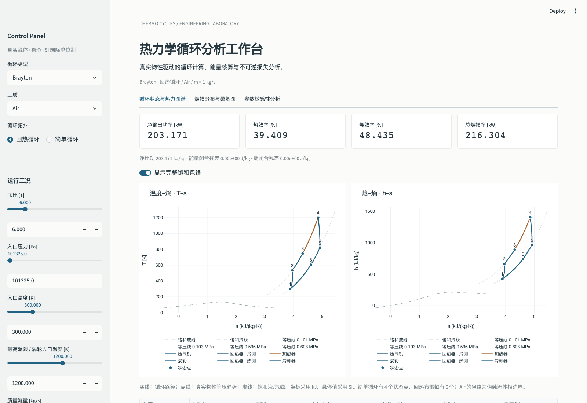

# Thermo Cycles

[中文](README.zh-CN.md) · [English](README.md) · [日本語](README.ja.md) · [Deutsch](README.de.md)

**面向工程科研与教学的真实流体热力循环仿真、能量核算与第二定律㶲分析平台。**

## 项目简介

本项目将具有类型注解的 Python 物理内核与 Streamlit / Plotly 交互式实验室连接起来。支持简单及回热式闭式布雷顿循环、简单朗肯循环，使用 CoolProp 真实流体物性，不假设恒定理想气体热容。项目注重可核查的假设、可复现的参考算例，并区分数值验证与实验验证。

本仓库只包含稳态热力循环。发动机、对置活塞和气体交换模型位于独立仓库 [Modular 0D Framework](https://github.com/1844514356zjc-dev/modular-0d-framework)。

## 核心功能

- 使用 CoolProp 的压力–焓、压力–熵闪蒸计算 Air、CO2、R134a、Water，工况必须满足物性范围与相态要求。
- 压气机、泵、涡轮分别设置等熵效率；泵功使用真实流体焓差，不采用固定比容近似。
- 等质量流量逆流回热器，包含回热度、两侧独立压损、变物性与内部夹点检查。
- 输出比功、吸热/排热、热效率、物理㶲、部件㶲损、㶲效率与守恒残差。
- T–s / h–s 图、真实物性等压线、饱和包络、编号状态点、SI 悬停值、能量与㶲桑基图。
- 参数扫描保留失败点诊断，可按最大热效率或净比功标出最佳可行采样点。
- JSON / CSV 完整报告包含工况、环境、单位、状态、路径、软件版本与警告。



## 快速启动

需要 Docker Engine / Docker Desktop 与 Compose；本地 Python 方式要求 Python 3.10+。在本仓库根目录运行：

```bash
# Docker Compose
docker-compose up
# Docker Compose plugin
docker compose up --build
```

```bash
python -m venv .venv
source .venv/bin/activate
python -m pip install -c requirements/validation-constraints.txt -e '.[ui,dev,benchmark]'
python -m streamlit run src/ui/app.py
```


浏览器打开 [http://localhost:8501](http://localhost:8501)。PowerShell 激活命令为 `.venv\Scripts\Activate.ps1`。容器采用 Python 3.10 slim、非 root 用户和健康检查，端口仅映射至本地回环地址。首次构建需要网络；8501 被占用时应先停止原服务。

本地开发使用 `requirements/validation-constraints.txt` 限定已检查的直接依赖；容器通过 `requirements.txt` 引入带 SHA-256 哈希的完整运行锁文件。基础镜像维护更新不保证整镜像逐字节复现。

## 结构与 Python API

`src/core/cycle_solver.py` 是不依赖 UI 的 SI 物理核心；`src/ui/app.py` 是界面入口；`src/ui/dashboard.py` 负责绘图、扫描和报告。`tests/`、`benchmarks/`、`docs/` 分别保存测试、独立参考对比与模型文档。

```python
from core.cycle_solver import (
    BraytonConfig,
    RankineConfig,
    solve_brayton,
    solve_rankine,
)

brayton = solve_brayton(BraytonConfig(), points=300)
rankine = solve_rankine(RankineConfig(), points=300)

print(brayton.thermal_efficiency)       # dimensionless
print(brayton.specific_work)            # J/kg
print(brayton.power)                    # W
print(brayton.exergy_destruction)       # J/kg, by component
print(brayton.destruction_rates)        # W, by component
print(rankine.states["4"].quality)      # wet-steam vapor mass fraction
```

## 物理模型与控制方程

稳态计算忽略动能和位能，机器绝热。外部热源与冷源为温度 T_H、T_C 的无限恒温热库；环境死态为 T0、p0。温度 K、压力 Pa、比焓与比能 J/kg、比熵 J/(kg·K)、功率 W、质量流量 kg/s。吸热、排热和净输出功分别取正值。

下列公式依次给出等熵出口、压气机/泵效率、涡轮效率、回热度与逆流焓分布、压损、第一定律、物理比㶲、部件㶲损、热量㶲及系统㶲效率。加热器和冷却器的㶲损包含与指定热库之间的不可逆传热；回热器作为两流体整体核算。

$$
h_{b_s}=h(p_b,s_a).
$$

$$
\eta_c=\frac{h_{b_s}-h_a}{h_b-h_a},
\qquad
h_b=h_a+\frac{h_{b_s}-h_a}{\eta_c},
\qquad
w_c=h_b-h_a.
$$

$$
\eta_t=\frac{h_a-h_b}{h_a-h_{b_s}},
\qquad
h_b=h_a-\eta_t(h_a-h_{b_s}),
\qquad
w_t=h_a-h_b.
$$

$$
\varepsilon=\frac{q_{\mathrm{reg}}}{q_{\max}},
\qquad
h_{c,o}=h_{c,i}+q_{\mathrm{reg}},
\qquad
h_{h,o}=h_{h,i}-q_{\mathrm{reg}}.
$$

$$
h_c(x)=h_{c,i}+xq_{\mathrm{reg}},
\qquad
h_h(x)=h_{h,i}-(1-x)q_{\mathrm{reg}}.
$$

$$
p_o=(1-\delta)p_i,\qquad 0\leq\delta<1.
$$

$$
w_{\mathrm{net}}=w_t-w_{\mathrm{in}},
\qquad
\eta_{\mathrm{th}}=\frac{w_{\mathrm{net}}}{q_{\mathrm{in}}},
\qquad
\dot W_{\mathrm{net}}=\dot m\,w_{\mathrm{net}}.
$$

$$
r_E=q_{\mathrm{in}}-q_{\mathrm{out}}-w_{\mathrm{net}}.
$$

$$
e=(h-h_0)-T_0(s-s_0).
$$

$$
e_D=e_i-e_o+\sum_j\left(1-\frac{T_0}{T_j}\right)q_j-w,
\qquad
e_D=T_0s_{\mathrm{gen}}\geq0,
$$

$$
\begin{aligned}
e_{D,\mathrm{machine}} &= T_0(s_o-s_i),\\
e_{D,\mathrm{reg}} &= T_0\big[(s_{c,o}-s_{c,i})+(s_{h,o}-s_{h,i})\big],\\
e_{D,\mathrm{heater}} &= T_0\left[(s_o-s_i)-\frac{q_{\mathrm{in}}}{T_H}\right],\\
e_{D,\mathrm{cooler}} &= T_0\left[(s_o-s_i)+\frac{q_{\mathrm{out}}}{T_C}\right].
\end{aligned}
$$

$$
e_{Q,H}=\left(1-\frac{T_0}{T_H}\right)q_{\mathrm{in}},
\qquad
e_{Q,C}=\left(1-\frac{T_0}{T_C}\right)q_{\mathrm{out}}.
$$

$$
\eta_{\mathrm{II}}=\frac{w_{\mathrm{net}}}{e_{Q,H}},
\qquad
r_X=e_{Q,H}-e_{Q,C}-w_{\mathrm{net}}-\sum_k e_{D,k}.
$$

$$
\mathrm{Relative\ Error}\ [\%]
=100\frac{|y_{\mathrm{solver}}-y_{\mathrm{reference}}|}
{|y_{\mathrm{reference}}|}.
$$

㶲效率以热输入㶲为分母。若 T_C<T0，冷源也提供㶲，此时不能将该值理解为以所有资源输入为分母的综合效率。桑基图会反转负排热㶲的方向。

回热器检查 201 个站位，必要时用 SciPy Brent 法求极限热量。这是离散夹点约束，不是连续域无温差交叉的严格证明。密集绘图曲线仍依赖机器路径的插值假设。

## 验证结果

参考 C 为 Water 理想朗肯循环：冷凝压力 10 kPa、锅炉出口压力 8 MPa、涡轮入口温度 773.15 K、饱和液泵入口、机器效率 1、压损 0。独立参考来自 Python `iapws` 的 IAPWS-IF97 实现，生产求解器使用 CoolProp HEOS。记录版本为 CoolProp 7.2.0、iapws 1.5.5。

| Case | Metric | Unit | Reference | Solver | Relative error % | Limit % | Result |
|---|---|---|---:|---:|---:|---:|---|
| C: ideal Rankine | specific_work | J/kg | 1261148.31 | 1261205.12 | 0.00450501 | 0.15 | PASS |
| C: ideal Rankine | heat_input | J/kg | 3199501.94 | 3199627.31 | 0.00391823 | 0.15 | PASS |
| C: ideal Rankine | thermal_efficiency | 1 | 0.394170195 | 0.394172508 | 0.000586757 | 0.15 | PASS |
| C: ideal Rankine | x4 | 1 | 0.810323225 | 0.810359306 | 0.00445263 | 0.15 | PASS |
| C: ideal Rankine | h1 | J/kg | 191812.295 | 191805.945 | 0.00331086 | 0.15 | PASS |
| C: ideal Rankine | h2 | J/kg | 199870.651 | 199864.344 | 0.00315555 | 0.15 | PASS |
| C: ideal Rankine | h3 | J/kg | 3399372.59 | 3399491.65 | 0.00350232 | 0.15 | PASS |
| C: ideal Rankine | h4 | J/kg | 2130165.93 | 2130228.13 | 0.00291988 | 0.15 | PASS |

该算例八项差异均低于 0.1%，最大约 0.00451%。这不构成所有流体/工况的普遍误差上界，也不是实验验证。脚本原有接受阈值为 0.15%；相对误差为 100×|计算值−参考值|/|参考值|。参考值为零时使用绝对误差。

A/B 采用 Air、p1=100000 Pa、T1=300 K、压比 4、T4=900 K、机器效率 1、压损 0，回热度分别为 0 与 0.75。解析参考采用 cp=1004.5 J/(kg·K)、gamma=1.4，生产代码使用真实物性：

| Case | Metric | Unit | Reference | Solver | Relative error % | Limit % | Result |
|---|---|---|---:|---:|---:|---:|---|
| A: simple Brayton | specific_work | J/kg | 149215.086 | 154249.456 | 3.3739 | 10 | PASS |
| A: simple Brayton | heat_input | J/kg | 456245.621 | 486798.623 | 6.69661 | 10 | PASS |
| A: simple Brayton | thermal_efficiency | 1 | 0.327049904 | 0.316865021 | 3.11417 | 10 | PASS |
| B: recuperated Brayton | specific_work | J/kg | 149215.086 | 154249.456 | 3.3739 | 10 | PASS |
| B: recuperated Brayton | heat_input | J/kg | 335813.504 | 347401.311 | 3.45067 | 10 | PASS |
| B: recuperated Brayton | thermal_efficiency | 1 | 0.444339148 | 0.444009423 | 0.0742057 | 10 | PASS |

这里的差异是物性模型差异，不应称为求解器离散误差；10% 仅为示例一致性筛查限值。三个算例按经典模型构造，不冒充教材编号例题或 NIST 官方循环认证数据。

```bash
python -m flake8 src tests benchmarks examples
python -m pytest -q
python benchmarks/validate_literature.py
```


独立仓库的循环测试覆盖能量/㶲闭合（指定边界绝对误差 <1e-6 J/kg）、理想极限、非法输入、湿蒸汽、流量缩放、桑基收支、报告与 UI 交互。GitHub Actions 配置 Python 3.10/3.12/3.14 检查，以及容器构建、健康与循环计算冒烟测试。实际运行状态以 Actions 为准。

## 适用边界与未来工作

- 布雷顿为闭式外加热循环，无燃烧、化学㶲及开放式燃机排气模型。
- 朗肯为简单循环，无抽汽给水回热或再热。湿膨胀不包含液滴侵蚀与非平衡凝结。
- 仅支持有效域内的纯流体及受支持伪纯流体，不含任意混合物相包络或固相。
- Air 的伪纯流体包络不能当作严格单组分饱和穹顶；端点效率不能唯一决定机器内部轨迹。
- 未来将加入 SciPy 约束优化与多目标 Pareto 研究、超临界 CO2 再压缩/分流循环、有限 UA 与自适应夹点模型、再热朗肯及独立实验对标和不确定性传播。

数学细节见[物理说明](docs/physics.md)，界面与导出见[仪表盘说明](docs/dashboard.md)，验证来源见[基准说明](benchmarks/README.md)。英文 README 提供完整技术叙述。

## 贡献与许可证

参见 [CONTRIBUTING.md](CONTRIBUTING.md) 与 [MIT 许可证](LICENSE)。第三方依赖保留各自许可证。参考资料：[CoolProp API](https://coolprop.org/coolprop/HighLevelAPI.html)、[IAPWS-IF97](https://iapws.org/technical-guidance/release/IF97-Rev)、[iapws 实现](https://iapws.readthedocs.io/en/latest/iapws.iapws97.html)。
