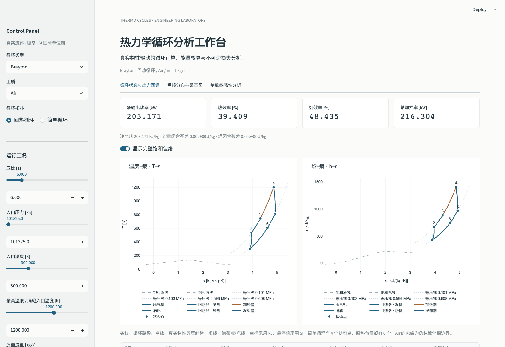
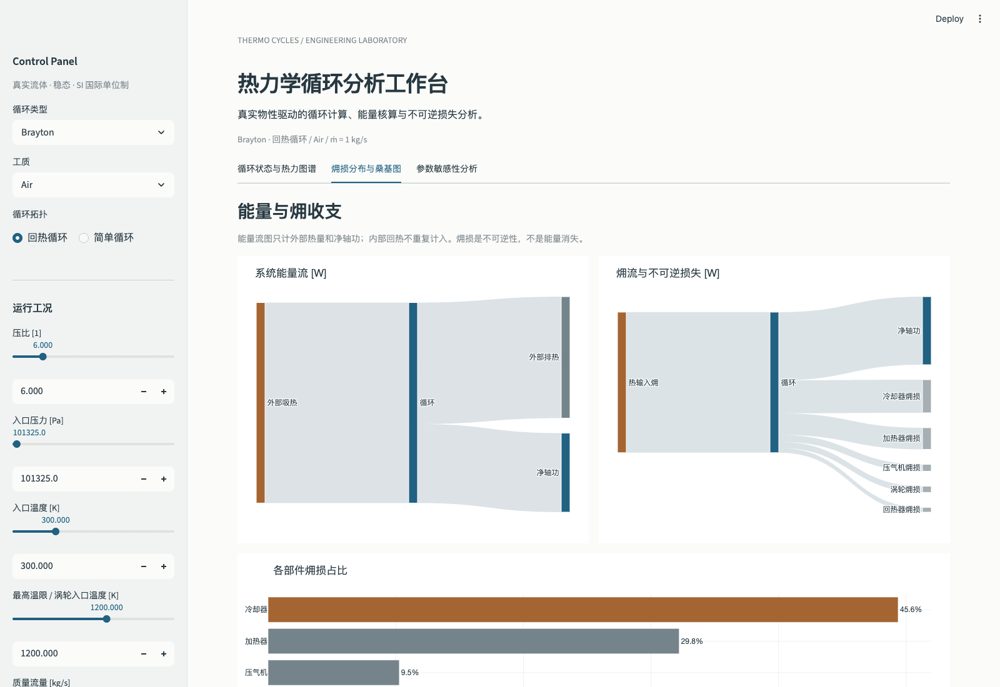
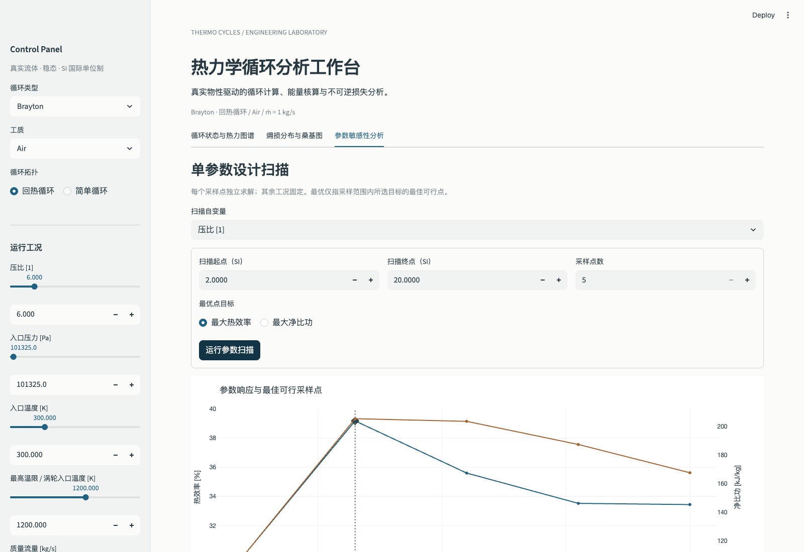

# 交互式工程工作台

## 启动

在项目根目录执行，以读取 `.streamlit/config.toml` 的统一浅色主题：

```bash
python -m pip install -e '.[ui,dev]'
python -m streamlit run src/ui/app.py
```

UI 要求 Streamlit >=1.56、Plotly >=5.18；物理核心的依赖不变。界面采用 Streamlit 1.56 可追踪标签页状态和按需渲染功能，不在隐藏标签页预先生成图表。支持从其他目录用 app.py 的绝对路径启动；此时 Streamlit 主题配置按当前工作目录查找。

- `src/ui/app.py`：输入控件、配置与缓存、三个标签页、错误展示与下载。
- `src/ui/dashboard.py`：纯计算展示层，包含 Plotly 图、扫描、最优采样点与序列化。不会改变物理核心的状态或公式。
- `tests/test_dashboard.py`：桑基收支、低温冷源㶲流方向、报告完整性、编号映射、扫描失败处理及 Streamlit 交互回归。

## 输入与拓扑

下拉选择 Air、CO2、R134a、Water，以及 Brayton / Rankine。
Brayton 可切换简单循环和回热循环。简单循环将回热度与回热器两侧压损设为零；加热器、冷却器的压损独立保留。Rankine 只提供后端已有的简单循环，没有虚构抽汽给水回热模型。

侧边栏滑块与精确数值框双向同步，效率与压损为 [1]；压力 Pa、温度 K、质量流量 kg/s。环境基准 T0/P0 和外部恒温热库 TH/TC 分开设置。初始参数随工质、循环类型切换；输入边界不等于物性有效域，后端仍会拒绝不满足相态、可用压比、第二定律或物性范围的工况。

工况不可行时显示 CycleError 诊断，不保留上一组成功结果的 KPI 和下载入口。Air 为伪纯流体，其低温朗肯闪蒸可能不被 CoolProp 支持。

## 图谱与状态编号

T-s、h-s 图并排显示。图轴使用明确标注的 kJ 比量，悬停显示 T [K]、P [Pa]、h [J/kg]、s [J/(kg K)]、物理㶲 e [J/kg]。
等压线使用真实物性 P,H 闪蒸；无效段以 NaN 断开。饱和包络由核心返回。可切换完整包络和围绕循环状态的局部视图。

简单 Brayton 显示 1–2–3–4，对应核心原始状态 1、2、4、5；Rankine 保留 1–2–3–4；回热 Brayton 保留完整的 1–2–3–4–5–6。原始计算结果在报告中保持不变，`display_state_mapping` 明确记录 UI 到核心的映射。

机器过程仍是核心定义的插值轨迹，不能当作真实叶轮内部过程。高点数只提高可视化采样密度。

## 能量与㶲流

两幅桑基图分别使用能量流率与㶲流率 [W]。内部回热不再次计入外部热输入。㶲图的损失支路分别给出每个部件的㶲损率；冷源低于环境温度时，将负排热㶲转为冷源流入循环的正向支路，避免不正确的负 Sankey 连线。

界面遵循后端定义，㶲效率分母为热输入㶲。当冷源还提供额外㶲时，这个效率不是以所有资源输入为分母的综合资源效率。部件柱状图显示占总㶲损的百分比，并标出最大不可逆来源。

## 参数扫描

Brayton 可扫描压比、最高温度、涡轮效率，回热拓扑还可扫描回热度。Rankine 可扫描锅炉出口压力、最高温度和涡轮效率。范围按参数 SI 单位填写，5–60 个点，默认压比范围 2–20。

每个点调用实际后端；保留失败点和诊断，曲线不跨失败段连线。目标可选择最大热效率或最大净比功。标记的是最佳可行采样点，不是连续全局最优解；最佳点落在端点时提示扩大范围。

扫描仅在提交后执行。更改基础工况、范围、采样点数、目标或拓扑后，旧扫描结果不会作为当前结果显示。扫描可独立下载包含基础配置与诊断的 JSON。

## 报告

JSON 与 CSV 都包含完整输入、环境、单位、软件版本、状态、性能、能量/㶲残差、部件㶲损、密集路径、饱和包络及模型警告。全部保持 SI，区别于图表轴或 KPI 的缩放显示。JSON 禁用非标准 NaN/Infinity 数值；非有限辅助数组值转为 null。

CSV 为 `path,value` 长格式，以层级路径和数组索引覆盖完整报告，例如 `result.paths.heater.T[0]`；包含 UTF-8 BOM，便于桌面表格软件读取中文。不是仅导出有限几个状态点的摘要。

## 验证与预览

```bash
python -m pytest -q
python -m ruff check src tests
```

当前环境验证：CoolProp 7.2.0、Streamlit 1.56.0、Plotly 5.18.0。浏览器检查包括标签页切换、绘图尺寸、扫描执行与 JSON 实际下载。AppTest 尚未完整模拟新式标签页状态持久化，因此扫描交互测试将生产 `sweep_panel` 放入最小可响应测试宿主；完整页面的标签切换另外通过浏览器验证。






